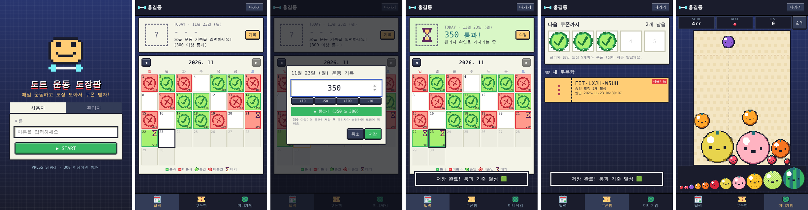

# 도트 운동 도장판 (Google Apps Script 웹앱)

도트(픽셀) 스타일의 운동 기록 + 관리자 승인 도장 + 쿠폰 자동 발급 + 미니게임 웹앱입니다.
화면은 스마트폰 세로 비율 **10:16** 으로 고정됩니다.

## 기능
| 구분 | 내용 |
|---|---|
| 사용자 | 이름만 입력해 로그인 → 날짜별 운동 수치 입력 (기준 **300 이상 = 초록 통과**, 미만 = 빨강 미통과) |
| 달력 | 이번 달 달력에 통과/미통과 색상, 승인 대기(모래시계), 승인(PASS 도장)/비승인(FAIL 도장) 표시. 상단 TODAY 카드에서 오늘 결과를 한눈에 확인 |
| 관리자 | 이름+비밀번호 로그인 → 기록별 **승인/비승인** 처리, 쿠폰 사용처리, 게임 기록 열람 |
| 쿠폰 | 승인 도장 N개(기본 5)마다 쿠폰 코드 자동 발급 → 사용자 쿠폰함에 표시 |
| 미니게임 | 도트 과일 합치기 (같은 과일 2개를 붙이면 한 단계 큰 과일 → 최종 수박). 점수는 `Games` 시트에 저장, TOP 10 순위 |

## 설치 방법
1. 구글 스프레드시트를 새로 만들고 **확장 프로그램 → Apps Script** 를 엽니다.
2. 아래 파일을 같은 이름으로 만들어 내용을 붙여넣습니다. (HTML 파일은 `+ → HTML`, 이름에 `.html` 은 빼고 입력)
   - `Code.gs`
   - `Index`, `Style`, `Sprites`, `Game`, `App` (HTML)
   - (선택) 프로젝트 설정에서 "appsscript.json 표시" 후 `appsscript.json` 붙여넣기 → 시간대 `Asia/Seoul`
3. 편집기에서 `setup` 함수를 한 번 실행해 권한을 승인합니다. (시트 6개가 자동 생성됩니다)
4. **배포 → 새 배포 → 웹 앱**
   - 실행 사용자: **나**
   - 액세스 권한: **모든 사용자** (또는 조직 내 사용자)
5. 발급된 웹앱 URL을 스마트폰에서 열면 됩니다.

> 스프레드시트와 분리된 독립형 스크립트라면 `Code.gs` 맨 위 `SPREADSHEET_ID` 에 시트 ID를 넣으세요.

## 시트 구조
| 시트 | 열 |
|---|---|
| `Users` | 이름, 가입일시, 최근접속 |
| `Records` | 날짜, 이름, 운동수치, 자동판정(통과/미통과), 승인상태(대기/승인/비승인), 처리관리자, 처리일시, 입력일시 |
| `Admins` | 관리자이름, 비밀번호, 메모 — **기본값 `admin` / `1234`, 반드시 변경하세요** |
| `Coupons` | 쿠폰코드, 이름, 발급일시, 발급사유, 사용여부(사용/미사용), 사용일시 |
| `Games` | 일시, 이름, 점수, 최고단계 |
| `Config` | `PASS_THRESHOLD`(통과 기준, 300), `COUPON_EVERY`(쿠폰 기준 도장 수, 5), `APP_TITLE`, `COUPON_PREFIX` |

- 관리자 비밀번호/관리자 추가는 `Admins` 시트에서 바로 수정하면 즉시 반영됩니다. (재배포 불필요)
- 기준 수치·쿠폰 조건도 `Config` 시트에서 바꾸면 즉시 반영됩니다.

## 참고
- 사용자는 오늘 및 과거 날짜만 기록할 수 있고, 관리자가 승인/비승인한 기록은 수정할 수 없습니다.
- 관리자는 이미 처리한 기록도 승인 ↔ 비승인으로 다시 바꿀 수 있습니다. (쿠폰은 같은 사유로 중복 발급되지 않음)
- 사용자 로그인은 이름만 사용하므로 보안이 필요한 용도에는 적합하지 않습니다.
