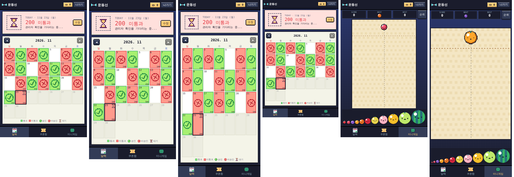
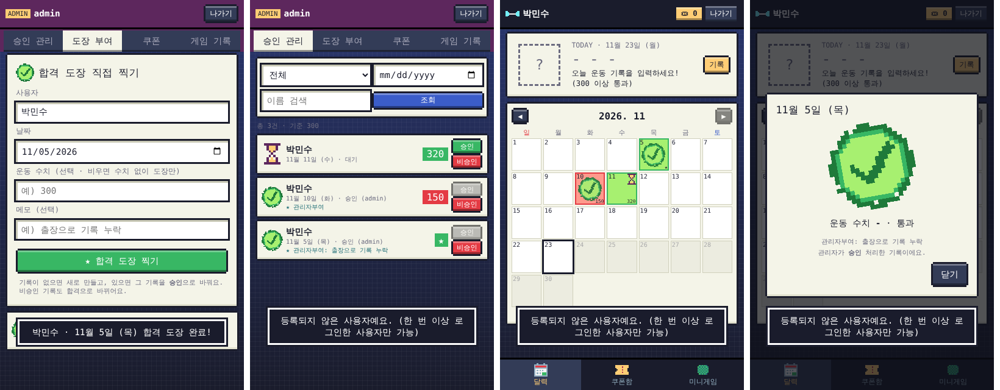
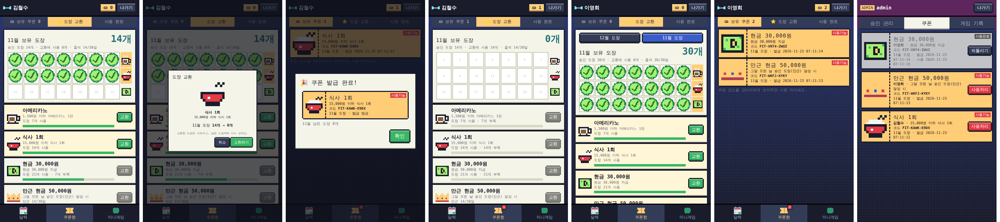

# 도트 운동 도장판 (Google Apps Script 웹앱)

도트(픽셀) 스타일의 운동 기록 + 관리자 승인 도장 + 쿠폰 자동 발급 + 미니게임 웹앱입니다.
휴대폰에서는 브라우저 화면을 **꽉 채우고**(주소창·메뉴 크기가 달라도 여백·잘림 없음), PC처럼 넓은 화면에서는 **9:14** 폰 모양으로 가운데 표시됩니다.

## 기능
| 구분 | 내용 |
|---|---|
| 사용자 | 이름만 입력해 로그인 → 날짜별 운동 수치 입력 (기준 **300 이상 = 초록 통과**, 미만 = 빨강 미통과) |
| 달력 | 이번 달 달력에 통과/미통과 색상, 승인 대기(모래시계), 승인(PASS 도장)/비승인(FAIL 도장) 표시. 상단 TODAY 카드에서 오늘 결과를 한눈에 확인 |
| 관리자 | 이름+비밀번호 로그인 → 기록별 **승인/비승인** 처리, **원하는 날짜에 합격 도장 직접 부여**, 쿠폰 사용처리, 게임 기록 열람 |
| 쿠폰 | 그달 모은 승인 도장을 **소모해서** 보상 쿠폰으로 교환 (아래 표). 보유 쿠폰은 상단 🎟 버튼 / 하단 쿠폰함 메뉴에서 언제든 확인 |
| 미니게임 | 도트 과일 합치기 (같은 과일 2개를 붙이면 한 단계 큰 과일 → 최종 수박). 점수는 `Games` 시트에 저장, TOP 10 순위 |

## 관리자 합격 도장 부여
관리자 화면 **[도장 부여]** 탭에서 사용자 · 날짜 · (선택) 수치 · (선택) 메모를 넣고 `합격 도장 찍기`를 누르면 그날 합격 도장이 찍힙니다.
- 그날 기록이 없으면 새로 만들고, 있으면(대기·비승인 포함) **승인**으로 바꿉니다.
- 수치를 비우면 달력에 `★` 로 표시되고 통과(초록)로 처리됩니다. 수치를 넣으면 그 수치 기준으로 색이 정해집니다.
- 부여한 도장도 도장 교환·만근에 똑같이 포함되며, `Records` 시트 `비고` 열에 `관리자부여: 메모` 가 남습니다.
- 오늘 이후 날짜, 한 번도 로그인하지 않은 이름에는 줄 수 없습니다.

## 도장 교환 보상 (`Rewards` 시트에서 수정 가능)
| 필요 도장 | 보상 |
|---|---|
| 7개 | 아메리카노 (1,500원 이하) |
| 14개 | 식사 1회 (15,000원 이하) |
| 21개 | 현금 30,000원 |
| 만근 | 현금 50,000원 — 그달 **모든 날짜**가 승인되면 월 1회 수령 (도장 소모 없음) |

- 도장은 **달마다 따로** 모이고, 다음 달로 넘어가지 않습니다.
- 교환하면 필요한 도장 수만큼 **소모**됩니다. 예) 14개 모아서 식사권 교환 → 그달 0개부터 다시 모음
- 월말 승인이 늦어질 수 있어서, 지난달 도장은 다음 달 **7일까지** 교환할 수 있습니다. (`Config`의 `EXCHANGE_GRACE_DAYS`)
- 쿠폰함 메뉴: **보유 쿠폰 / 도장 교환 / 사용 완료** 탭. 관리자는 쿠폰 탭에서 `사용처리` 합니다.

## 설치 방법
1. 구글 스프레드시트를 새로 만들고 **확장 프로그램 → Apps Script** 를 엽니다.
2. [`apps-script/`](apps-script/) 폴더의 파일을 같은 이름으로 만들어 내용을 붙여넣습니다. (한 번에 복사: [`apps-script/ALL_IN_ONE.txt`](apps-script/ALL_IN_ONE.txt), 압축 파일: `dot-stamp-coupon-apps-script.zip`) (HTML 파일은 `+ → HTML`, 이름에 `.html` 은 빼고 입력)
   - `Code.gs`
   - `Index`, `Style`, `Sprites`, `Game`, `App` (HTML)
   - (선택) 프로젝트 설정에서 "appsscript.json 표시" 후 `appsscript.json` 붙여넣기 → 시간대 `Asia/Seoul`
3. 편집기에서 `setup` 함수를 한 번 실행해 권한을 승인합니다. (시트 7개가 자동 생성됩니다)
4. **배포 → 새 배포 → 웹 앱**
   - 실행 사용자: **나**
   - 액세스 권한: **모든 사용자** (또는 조직 내 사용자)
5. 발급된 웹앱 URL을 스마트폰에서 열면 됩니다.

> 스프레드시트와 분리된 독립형 스크립트라면 `Code.gs` 맨 위 `SPREADSHEET_ID` 에 시트 ID를 넣으세요.

## 시트 구조
| 시트 | 열 |
|---|---|
| `Users` | 이름, 가입일시, 최근접속 |
| `Records` | 날짜, 이름, 운동수치, 자동판정(통과/미통과/관리자부여), 승인상태(대기/승인/비승인), 처리관리자, 처리일시, 입력일시, 비고 |
| `Admins` | 관리자이름, 비밀번호, 메모 — **기본값 `admin` / `1234`, 반드시 변경하세요** |
| `Coupons` | 쿠폰코드, 이름, 발급일시, 보상ID, 보상이름, 대상월, 소모도장, 사용여부(사용/미사용), 사용일시 |
| `Rewards` | 보상ID, 보상이름, 설명, 필요도장(숫자 또는 `만근`), 아이콘(coffee/meal/cash/crown/ticket) |
| `Games` | 일시, 이름, 점수, 최고단계 |
| `Config` | `PASS_THRESHOLD`(통과 기준, 300), `EXCHANGE_GRACE_DAYS`(지난달 도장 교환 유예일, 7), `APP_TITLE`, `COUPON_PREFIX` |

- 관리자 비밀번호/관리자 추가는 `Admins` 시트에서 바로 수정하면 즉시 반영됩니다. (재배포 불필요)
- 기준 수치·보상 목록도 `Config` 시트에서 바꾸면 즉시 반영됩니다.

## 코드 수정 후
`apps-script/` 파일을 고쳤다면 `python3 build.py` 로 `ALL_IN_ONE.txt` 와 zip 을 다시 만드세요.

## 참고
- 사용자는 오늘 및 과거 날짜만 기록할 수 있고, 관리자가 승인/비승인한 기록은 수정할 수 없습니다.
- 관리자는 이미 처리한 기록도 승인 ↔ 비승인으로 다시 바꿀 수 있습니다.
- 이전 버전으로 이미 `Coupons` 시트가 만들어졌다면, 열 구성이 바뀌었으니 `Coupons` 시트를 삭제 후 다시 실행하세요. (자동 재생성)
- 사용자 로그인은 이름만 사용하므로 보안이 필요한 용도에는 적합하지 않습니다.
