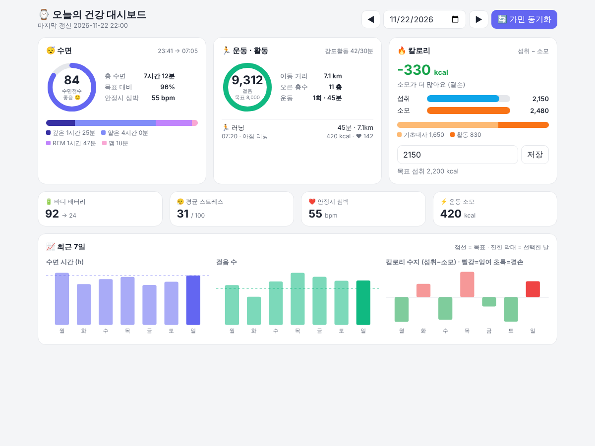

# ⌚ 가민 → 구글 시트 → 오늘의 건강 대시보드

가민 데이터를 **매일 자동으로 구글 스프레드시트에 누적**하고, **웹 페이지(HTML)** 에서
오늘의 **수면 · 운동 · 섭취/소모 칼로리**를 한눈에 보는 Google Apps Script 프로젝트입니다.



| 파일 | 역할 |
|---|---|
| `Code.gs` | 가민 API 호출, 시트 누적, 자동 실행, 웹앱 서버 |
| `Index.html` | 대시보드 화면 (모바일/다크모드 지원) |
| `appsscript.json` | 시간대(Asia/Seoul)·권한 설정 |
| `get_garmin_apikey.py` | **APIKEY 발급 도우미** (내 PC에서 1회 실행) |

---

## ⚠️ 먼저 알아둘 점: "가민 개인용 API 키"

가민은 개인에게 단순한 API 키를 발급해주지 않습니다(공식 Health API는 기업 심사 필요).
그래서 이 프로젝트는 가민 커넥트 앱과 같은 방식의 **로그인 토큰(약 1년 유효)** 을
`APIKEY` 로 저장해 사용합니다. 토큰은 오픈소스 라이브러리 [garth](https://github.com/matin/garth)로 발급합니다.

- 비공식 방식이라 가민이 로그인 방식을 바꾸면 동작하지 않을 수 있습니다.
- 토큰이 만료되면(약 1년) 2단계만 다시 하면 됩니다.

---

## 🚀 설치 (10분)

### 1. 스프레드시트 + 스크립트 만들기
1. 새 구글 스프레드시트 생성 → **확장 프로그램 > Apps Script**
2. `Code.gs` 내용을 붙여넣기
3. 왼쪽 `+` → **HTML** → 이름을 `Index` 로 만들고 `Index.html` 내용 붙여넣기
4. ⚙ 프로젝트 설정 → **"appsscript.json 매니페스트 파일 표시"** 체크 → `appsscript.json` 내용 붙여넣기
5. 저장 후 스프레드시트를 새로고침하면 상단에 **⌚ 가민** 메뉴가 생깁니다.

> 💡 API 없이 화면부터 보고 싶다면: **⌚ 가민 > 🧪 샘플 데이터 넣기** → 5단계로 바로 이동

### 2. APIKEY 발급 (내 PC에서 1회)
```bash
pip install garth
python get_garmin_apikey.py
```
가민 이메일/비밀번호(2단계 인증 코드)를 입력하면 아래처럼 한 줄이 출력됩니다.
```
{"oauth_token": "...", "oauth_token_secret": "...", "mfa_token": null, "domain": "garmin.com"}
```

### 3. APIKEY 저장 (둘 중 편한 방법)
- **메뉴 방식**: 시트 메뉴 **⌚ 가민 > 🔑 APIKEY 등록/변경** → 출력된 한 줄 붙여넣기
- **직접 방식**: Apps Script ⚙ 프로젝트 설정 → **스크립트 속성** → 속성 `APIKEY`, 값에 한 줄 붙여넣기

**⌚ 가민 > 🩺 연결 테스트** 로 확인하세요.

### 4. 데이터 쌓기
- **📥 최근 30일 가져오기** : 과거 데이터 한 번에 채우기
- **⏰ 매일 자동 동기화 켜기** : 매일 07시(지난밤 수면 확정), 22시(하루 활동 마감) 자동 실행

### 5. 대시보드 웹페이지 배포
Apps Script 오른쪽 위 **배포 > 새 배포 > 유형: 웹 앱**
- 실행 사용자: **나**, 액세스 권한: **나만** (본인 건강 데이터이므로 권장)
- 발급된 URL을 휴대폰 홈 화면에 추가하면 앱처럼 사용할 수 있습니다.

---

## 📊 시트 구성

**`일일요약`** (하루 1행, 같은 날짜는 덮어쓰기)
수면점수 · 총수면 · 깊은/얕은/REM/깨어있음 · 취침/기상 · 걸음수 · 거리 · 강도활동 · 층수 ·
안정시심박 · 스트레스 · 바디배터리 · 총/활동/기초대사 소모 · 섭취(가민/직접입력) · 운동 횟수/시간/칼로리

**`활동기록`** (운동 1건 = 1행, 활동ID로 중복 방지)
날짜 · 시작시각 · 활동명 · 종류 · 시간 · 거리 · 칼로리 · 평균/최대 심박

시트 데이터로 구글 시트의 차트·피벗을 자유롭게 추가해도 됩니다(컬럼 순서만 유지).

## 🍽 섭취 칼로리
가민은 MyFitnessPal 연동 시에만 섭취 칼로리를 제공합니다. 그래서
- 대시보드 칼로리 카드에서 **직접 입력 → 저장** 하거나
- 시트 `섭취-직접입력(kcal)` 칸에 바로 입력할 수 있습니다.
직접 입력값이 있으면 우선 사용하고, 자동 동기화가 덮어쓰지 않습니다.

## ⚙ 설정 바꾸기
`Code.gs` 맨 위 `CONFIG` 에서 목표 수면시간, 목표 섭취칼로리, 자동 동기화 시각 등을 바꿀 수 있습니다.

## 🛠 문제 해결
| 증상 | 해결 |
|---|---|
| `APIKEY 가 없습니다` | 3단계 다시 확인 (속성 이름은 정확히 `APIKEY`) |
| `토큰 발급 실패(401)` | APIKEY 만료 → 2·3단계 다시 실행 |
| `가민 API 오류 429` | 요청 과다. 잠시 후 다시 시도 |
| 수면 데이터가 비어 있음 | 시계를 동기화한 뒤 아침에 다시 동기화 (수면은 "그날 아침에 끝난 잠" 기준) |

🔒 `APIKEY` 는 비밀번호와 같습니다. 스크립트/시트를 공유할 때 스크립트 속성은 복사되지 않지만,
다른 사람에게 편집 권한을 줄 때는 주의하세요.
