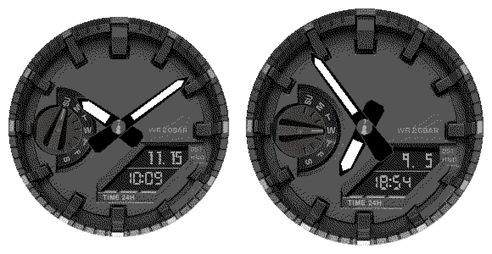

# Octa Ana-Digi — Garmin fēnix 8 Solar 워치페이스

Amazfit GTR(454×454, `HMDIAL` 포맷) 워치페이스를 분석해 Garmin Connect IQ 워치페이스로 이식한 프로젝트입니다.



## 대상 기기
| 제품 ID | 화면 |
|---|---|
| `fenix8solar47mm` | 260×260 MIP (64색) |
| `fenix8solar51mm` | 280×280 MIP (64색) |

## 원본 파일 분석 결과 (HMDIAL)
| 섹션 | 내용 | 이식 방식 |
|---|---|---|
| Background | 454×454 배경 + 266×266 미리보기 | 260/280으로 축소, 64색 MIP 팔레트로 Floyd-Steinberg 디더링 |
| Time | 7세그 숫자(15×27) ×10, 시/분 위치 (237,256 / 281,300 , y=320) | 비트맵 축소, 좌표는 런타임 스케일 |
| Date | 도트매트릭스 숫자 ×10, 월(282) · 일(326), y=277, 구분점 | 비트맵 + 점은 직접 그림 |
| WeekDay | 108×108 요일 다이얼 이미지 7장(월요일 시작), 위치 (47,180) | Garmin `day_of_week`(일=1) → 월요일 기준 인덱스 변환 |
| AnalogDial | 시침(56×173, 회전중심 27,112), 분침(58×264, 회전중심 29,184) | 원본 형태를 측정해 폴리곤으로 재현(MIP에서 선명) |

## fēnix 8 Solar에 맞춘 변경 사항
- **MIP 64색 대응**: 어두운 배경이 검정으로 뭉개지지 않도록 밝기 보정(×1.3) 후 디더링. 리소스는 미리 양자화(`dithering="none"`).
- **바늘**: 비트맵 회전 대신 폴리곤으로 그려 저전력/MIP에서 안정적으로 표시. 야광부는 햇빛 아래 가독성을 위해 흰색.
- **초침 없음**: MIP 워치페이스는 슬립 모드에서 1분마다 갱신되므로 원본처럼 시·분만 표시.
- **12/24시간**: 기기 설정을 따름(12시간제일 때 앞자리 0 생략).
- **상표 제거**: 원본 다이얼의 타사 브랜드 로고는 지웠습니다(개인용으로도 스토어 배포 시 문제 소지).

## 빌드
Connect IQ SDK 7.x 이상 + 기기 파일(SDK Manager에서 fēnix 8 Solar 다운로드) 필요.
```bash
monkeyc -f monkey.jungle -d fenix8solar47mm -o bin/OctaDial.prg -y <developer_key.der>
connectiq && monkeydo bin/OctaDial.prg fenix8solar47mm   # 시뮬레이터
```
실기기: `bin/OctaDial.prg`를 USB로 시계의 `GARMIN/APPS/` 폴더에 복사.

## 리소스 재생성
```bash
python3 tools/extract.py <원본.bin> img/          # 이미지 33장 추출
python3 tools/build.py img/ .                     # MIP 리소스 생성
python3 tools/preview.py . preview.png            # 미리보기 렌더링
```
